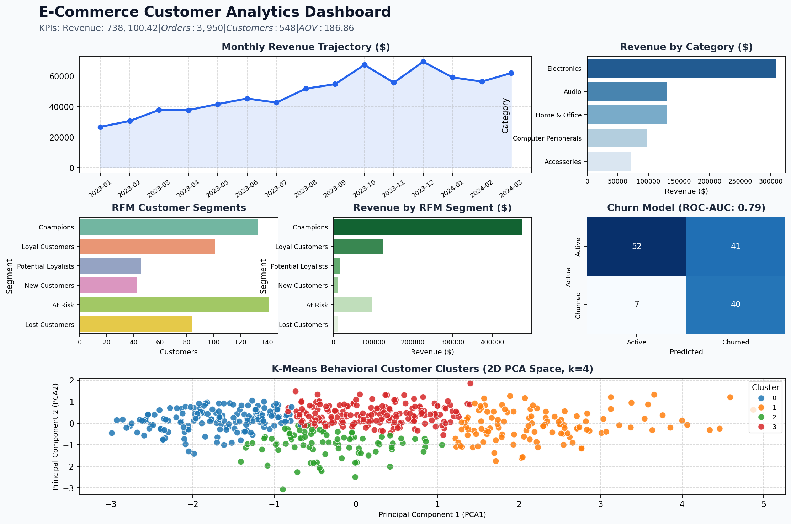

# E-Commerce Customer Analytics

[](https://www.python.org/)
[](https://streamlit.io/)
[](https://scikit-learn.org/)
[](https://www.sqlite.org/)

> **Internship & Portfolio Project**: An end-to-end Data Science and Machine Learning web application designed to analyze transaction patterns, quantify customer loyalty through RFM analysis, group buyer behaviors with K-Means clustering, and proactively predict customer churn with Logistic Regression.

---

## Overview

This project was built as a portfolio and internship submission demonstrating foundational to intermediate Data Science capabilities. Using realistic sample transaction data inspired by public retail benchmarks, the project integrates data preprocessing, relational SQL querying, exploratory data analysis, unsupervised clustering, supervised machine learning, and an interactive Streamlit dashboard.

---

## Problem Statement

Modern e-commerce businesses generate vast volumes of transactional data but frequently struggle to answer critical operational questions:
- Where is revenue concentrated across product categories and regions?
- Which customer cohorts represent the highest recurring lifetime value?
- How can we systematically identify customers at risk of abandoning the brand?
- How do we segment customers mathematically to personalize retention and marketing campaigns?

Without automated segmentation and predictive analytics, businesses risk misallocating marketing budgets and reacting too late to customer attrition.

---

## Objectives

1. **Revenue & Performance Visibility**: Quantify store KPIs (Total Revenue, Orders, Unique Customers, Average Order Value).
2. **Robust Data Preprocessing**: Clean transactional anomalies, eliminate duplicate records, impute missing values, and validate numerical constraints.
3. **Behavioral RFM Segmentation**: Score customers across Recency, Frequency, and Monetary dimensions to classify them into actionable cohorts (e.g., Champions, Loyal, At Risk).
4. **Unsupervised Clustering**: Standardize customer metrics, evaluate optimal $k$ using Elbow and Silhouette metrics, and project K-Means clusters onto 2D PCA space.
5. **Supervised Churn Risk Modeling**: Train an interpretable Logistic Regression model adhering strictly to ML best practices (train/test data isolation prior to scaling) to detect churn indicators.
6. **Relational Database Interoperability**: Embed SQLite database integration for cross-functional SQL analytical querying.
7. **Interactive Dashboard**: Deliver an intuitive, filterable Streamlit UI for business stakeholders.

---

## Features

- **Executive KPI Dashboard**: Instant summary of Total Revenue, Orders, Unique Customers, and AOV.
- **Dynamic Multi-Dimensional Filtering**: Real-time cross-filtering by date range, category, country, and gender.
- **Sales Analytics**: Monthly revenue trends, daily order volume, product Pareto rankings, and geographic breakdown.
- **Customer Lifetime Analytics**: Single-order vs. repeat buyer ratios, spending distributions, and ranked customer profiles.
- **RFM Segmentation Engine**: Rule-based categorization into 6 business segments with revenue contribution shares.
- **K-Means Cluster Explorer**: Dynamic cluster selection ($k=2$ to $6$), WCSS inertia curves, silhouette validation, and 2D PCA visualization.
- **Predictive Churn Classifier**: Transparent inactivity-based churn classification, confusion matrix heatmap, feature importance weights, and real-time customer risk calculator.
- **Integrated SQLite Query Runner**: Run pre-configured and custom SQL queries directly against the relational database.
- **Data Preprocessing Audit**: Real-time view of removed duplicates, imputed values, and schema verification.

---

## Tech Stack

| Domain | Technology / Library | Role |
|---|---|---|
| **Programming Language** | Python 3.10+ | Core pipeline and logic execution |
| **Data Manipulation** | Pandas, NumPy | Data wrangling, aggregation, and vectorized operations |
| **Machine Learning** | Scikit-learn, Joblib | K-Means clustering, PCA, Logistic Regression pipeline & persistence |
| **Data Visualization** | Matplotlib, Seaborn | Distribution plots, trendlines, PCA projections, heatmaps |
| **Relational Database** | SQLite (`sqlite3`) | Embedded SQL analytics on clean tables |
| **Frontend / Dashboard** | Streamlit | Interactive, reactive web interface |
| **Notebook Analysis** | Jupyter Notebook (`nbformat`, `ipykernel`) | Step-by-step reproducible experimentation narrative |

---

## Dataset

- **Type**: Synthetically generated, realistic sample retail transaction dataset designed for development and portfolio demonstration.
- **Records**: ~4,000 transactions across 15 months (January 2023 – March 2024).
- **Customers**: ~550 unique customers spanning 6 countries and 5 retail categories.
- **Anomalies Injected for Cleaning**: Guest checkouts (missing CustomerID), returns/refunds (negative quantities), duplicate records, missing prices, and unformatted dates.

> *Note: This dataset contains synthetic sample data for educational and portfolio demonstration purposes. It does not represent proprietary records of any real commercial organization.*

---

## Project Architecture

```
ecommerce-customer-analytics/
│
├── app.py                         # Streamlit multi-page web application
├── requirements.txt               # Pinned Python package dependencies
├── README.md                      # Comprehensive project documentation
├── .gitignore                     # Git tracking exclusions (cache, models, env)
│
├── data/
│   ├── ecommerce_data.csv         # Raw sample transactions CSV
│   └── ecommerce.db               # Embedded SQLite database
│
├── notebooks/
│   └── ecommerce_analysis.ipynb   # 11-step end-to-end Data Science Jupyter notebook
│
├── src/
│   ├── data_cleaning.py           # Anomaly handling and data validation pipeline
│   ├── analysis.py                # Sales, customer metrics & SQLite execution helper
│   ├── rfm_analysis.py            # Quintile-based RFM scoring and segmentation
│   ├── customer_segmentation.py   # K-Means clustering, Elbow method, PCA projection
│   ├── churn_prediction.py        # Supervised Logistic Regression pipeline & evaluation
│   ├── generate_data.py           # Synthetic dataset generator utility
│   ├── build_notebook.py          # Programmatic Jupyter notebook generator
│   └── generate_preview.py        # Automated preview visualization generator
│
├── sql/
│   └── ecommerce_queries.sql      # 10 core analytical queries (SQLite compatible)
│
├── models/
│   └── churn_model.pkl            # Serialized Scikit-learn Pipeline (Scaler + Model)
│
└── images/
    └── dashboard_preview.png      # Composite multi-panel dashboard preview
```

---

## Data Science Workflow

```
[Raw CSV Data]
       │
       ▼
[Data Cleaning Pipeline] ──► Audit: Duplicates, Nulls, Negative Quantities, Type Casting
       │
       ├──────────────────────────────┬──────────────────────────────┐
       ▼                              ▼                              ▼
[Exploratory Data Analysis]   [SQLite DB Population]          [RFM Calculation]
  • Monthly Sales Trends        • Relational Queries            • Recency, Frequency, Monetary
  • Category & Country Share    • Aggregations & Joins          • Quintile Scoring (1 - 5)
  • Top-Selling Products                                             │
                                                                     ├────────────────────────┐
                                                                     ▼                        ▼
                                                          [K-Means Clustering]       [Churn Prediction]
                                                            • Log1p + StandardScale    • Inactivity Target
                                                            • Elbow (WCSS) & Sil.      • Train/Test Split
                                                            • PCA 2D Projection        • Scaled Pipeline
                                                                                       • Logistic Regression
                                                                                       • Confusion Matrix
                                                                                              │
                                                                                              ▼
                                                                                  [Business Recommendations]
                                                                                  [Interactive Streamlit App]
```

---

## RFM Analysis

RFM analysis segments customers using three behavioral pillars:
1. **Recency ($R$)**: Number of days since the customer's most recent order. (Lower days = more active = higher score).
2. **Frequency ($F$)**: Total number of distinct orders placed. (Higher count = higher score).
3. **Monetary ($M$)**: Total gross spending accumulated. (Higher spend = higher score).

### Segment Definitions

| Segment | Criteria | Strategic Action |
|---|---|---|
| **Champions** | $R \ge 4$, $F \ge 4$, $M \ge 4$ | Reward with VIP status, early access to new releases, and advocacy incentives. |
| **Loyal Customers** | $R \ge 3$, $F \ge 3$, $M \ge 3$ | Upsell higher-value products; engage with recurring loyalty perks. |
| **Potential Loyalists** | $R \ge 3$, $F < 3$, $M \ge 2$ | Offer membership programs or recommend complementary products. |
| **New Customers** | $R \ge 4$, $F \le 2$ | Deliver educational onboarding drip sequence and 14-day re-purchase voucher. |
| **At Risk** | $R \le 2$, $F \ge 2$, $M \ge 2$ | Automated win-back campaigns, feedback surveys, and limited-time discounts. |
| **Lost Customers** | $R \le 2$, $F \le 2$, $M \le 2$ | Low-cost reactivation email sequence; archive if non-responsive. |

---

## Customer Segmentation (K-Means)

1. **Preprocessing**: Features ($R, F, M$) exhibit substantial right-skewness. A `np.log1p` transformation is applied, followed by zero-mean unit-variance `StandardScaler`.
2. **Model Selection**: Evaluated $k \in [2, 6]$ via:
   - **Elbow Method (Inertia/WCSS)**: Measures within-cluster compactness.
   - **Silhouette Score**: Measures cluster cohesion vs. separation. Optimal trade-off observed at $k=4$ (Silhouette $\approx 0.368$).
3. **Dimensionality Reduction**: Principal Component Analysis (PCA) reduces the 3D feature space to 2 components (`PCA1`, `PCA2`), allowing clear 2D scatter plotting with cluster hues.

---

## Churn Prediction

### Definition & Target Leakage Prevention
- **Churn Label**: A customer is labeled churned (`IsChurned = 1`) if inactive for $>90$ days.
- **Leakage Prevention**: Because the target is derived from inactivity, including `Recency` directly as an input feature causes artificial 100% predictive leakage. To ensure realistic, generalizable learning, features are restricted to:
  - `Frequency`
  - `Monetary`
  - `AverageOrderValue`
  - `CustomerAge`
- **Methodology**:
  - Stratified 75/25 Train-Test split.
  - Preprocessing (`StandardScaler`) is fitted strictly on `X_train` to prevent data leakage.
  - Balanced class weights applied to `LogisticRegression` to handle class imbalance.

### Evaluation Metrics (Unseen Test Set)
- **Accuracy**: $\approx 65.7\%$
- **Precision**: $\approx 49.4\%$
- **Recall**: $\approx 85.1\%$ *(High sensitivity ensures the business captures over 85% of at-risk customers)*
- **F1-Score**: $\approx 0.625$
- **ROC-AUC**: $\approx 0.792$

---

## SQL Analysis

All 10 required SQLite queries are stored in [`sql/ecommerce_queries.sql`](file:///c:/Users/garga/OneDrive/Desktop/E-Commerce%20Customer%20Analytics/sql/ecommerce_queries.sql) and can be executed via the Streamlit SQL Explorer:
1. `Total Revenue`
2. `Total Orders`
3. `Total Customers`
4. `Revenue by Category`
5. `Top 10 Best Selling Products`
6. `Top 10 Most Valuable Customers`
7. `Monthly Revenue and Order Volume`
8. `Overall Average Order Value (AOV)`
9. `High-Spending Customers (> $1,500)`
10. `Inactive Customers (> 90 Days)`

---

## Dashboard Preview



---

## Installation

### 1. Clone the Repository
```bash
git clone https://github.com/your-username/ecommerce-customer-analytics.git
cd ecommerce-customer-analytics
```

### 2. Create and Activate Virtual Environment
```bash
# Windows
python -m venv .venv
.venv\Scripts\activate

# macOS / Linux
python3 -m venv .venv
source .venv/bin/activate
```

### 3. Install Required Dependencies
```bash
pip install -r requirements.txt
```

---

## How to Run

### Run the Interactive Web Dashboard
```bash
streamlit run app.py
```
Open your web browser at `http://localhost:8501`.

### Run the Data Cleaning Pipeline Separately
```bash
python src/data_cleaning.py
```

### Train Churn Model Separately
```bash
python src/churn_prediction.py
```

### Open the Jupyter Notebook
```bash
jupyter notebook notebooks/ecommerce_analysis.ipynb
```

---

## Key Insights

1. **Pareto Revenue Concentration**: The top **10% of customers account for 45.6%** of total store revenue, highlighting the importance of VIP retention.
2. **Category Dominance**: **Electronics** leads all categories with **41.8%** revenue share ($308,000+), driven by high-ticket items like 4K Monitors.
3. **High-Value Loyalty Pillar**: The **Champions** segment contributes **64.4% of total revenue**, despite representing only ~24% of the customer base.
4. **Substantial At-Risk Volume**: Approximately **41.1% of accounts** (225 customers) are currently inactive (>90 days), presenting an immediate revenue-recovery opportunity through automated win-back workflows.

---

## Future Improvements

- [ ] Incorporate time-series forecasting (e.g., ARIMA or Prophet) to predict monthly inventory demand.
- [ ] Implement multi-touch customer acquisition channel attribution.
- [ ] Add market basket analysis (Apriori algorithm) for product cross-sell recommendations.
- [ ] Implement automated CI/CD unit testing for data validation pipelines.

---

## Author

- **Project**: E-Commerce Customer Analytics
- **Role**: Senior Data Scientist / Internship Portfolio Project
- **Purpose**: Data Science Internship Demonstration & GitHub Portfolio
- **License**: MIT
